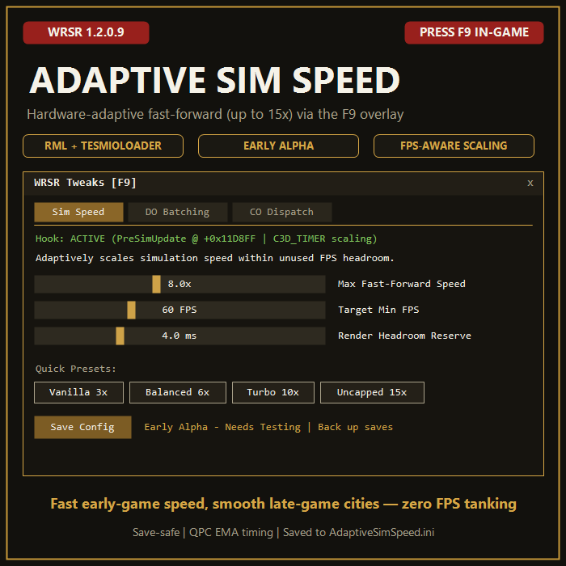
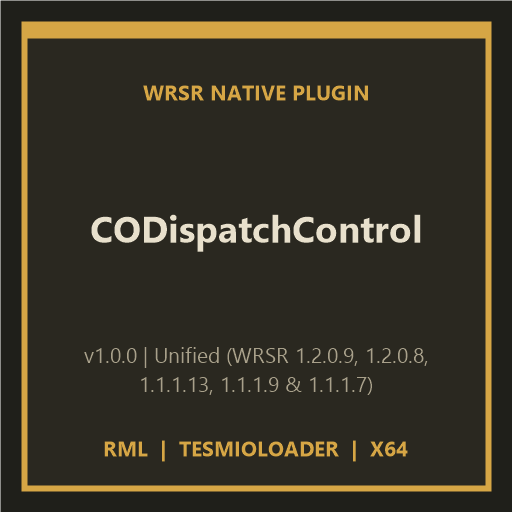
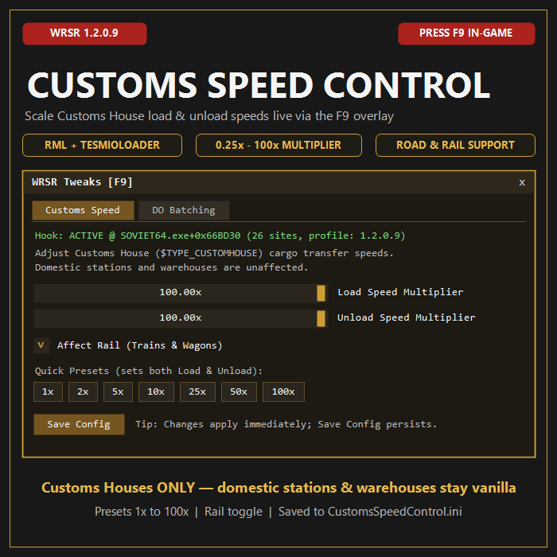
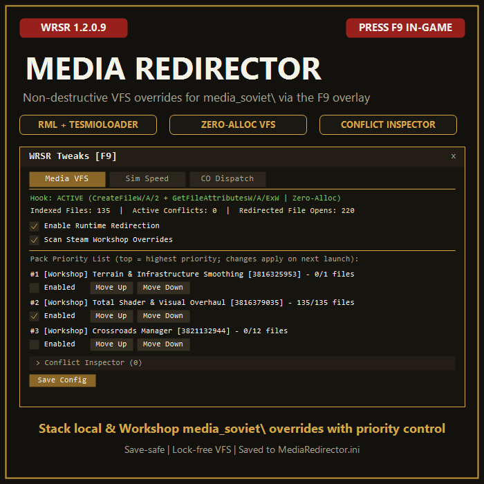
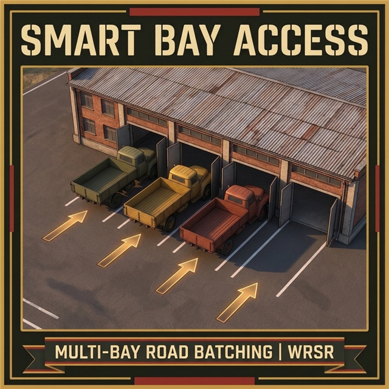
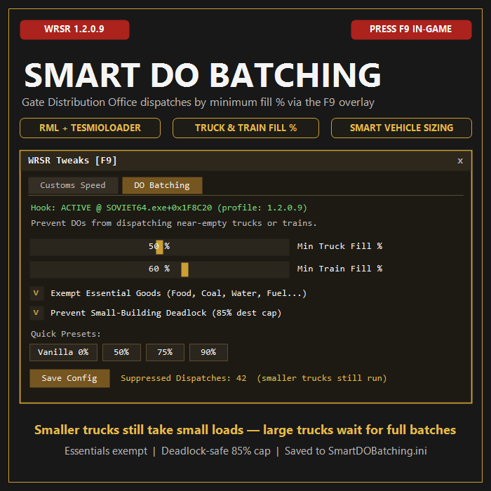
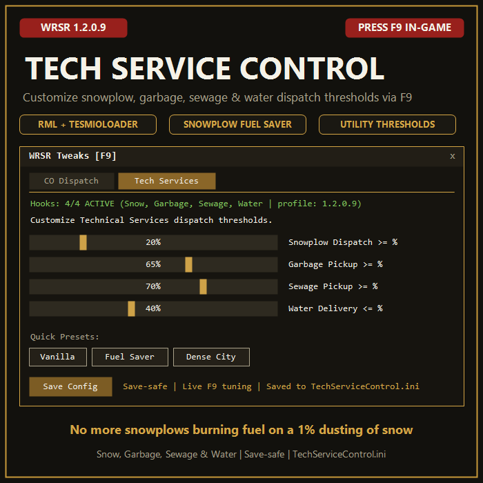

# Workers & Resources: Soviet Republic — C++ Modding Workshop

Native x64 C++20 plugin workspace for **Workers & Resources: Soviet Republic** (`SOVIET64.exe`), targeting both **Republic Mod Loader (RML)** and **TesmioLoader**.

> **Heads Up / Project Notice:**  
> This repository is **mostly vibe coded (AI-assisted)** and **manually tested and checked**. There is no automated test suite, and native memory/API hooks for `SOVIET64.exe` can break or behave unexpectedly across game updates or alongside other mods. Always back up your saves before testing, inspect the code yourself if needed, and use at your own risk.

## Mods

<!-- COLLECTION_MODS_START -->
> **Steam Workshop Collection:** Subscribe to all mods at once via the [**WRSR Tweaks — Complete Collection**](https://steamcommunity.com/sharedfiles/filedetails/?id=3846399315).

| Preview | Mod | Status | Description |
|---|---|---|---|
|  | [`AdaptiveSimSpeed`](mods/AdaptiveSimSpeed) | v1.0.9 (Alpha) | Native x64 C++20 plugin for **Workers & Resources: Soviet Republic** (`SOVIET64.exe`) that turns Fast Forward (`>>`) into a hardware-adaptive fast-forward (up to `15.0x`) via the shared **`F9`** multi-mod overlay (`WRSR Tweaks [F9]`), scaling simulation speed dynamically to your available CPU/GPU headroom without tanking FPS in late-game cities. ([Workshop](https://steamcommunity.com/sharedfiles/filedetails/?id=3846322975) · [Releases](https://github.com/ZydraHydra/WorkersAndResources-Modding/releases)) |
|  | [`CODispatchControl`](mods/CODispatchControl) | v1.0.1 (Alpha) | Native x64 plugin for **Workers & Resources: Soviet Republic** (`SOVIET64.exe`) that optimizes Construction Office (CO) vehicle dispatch so COs match truck and bus sizes to actual construction demand instead of sending oversized vehicles for tiny remaining workloads. ([Workshop](https://steamcommunity.com/sharedfiles/filedetails/?id=3846041311) · [Releases](https://github.com/ZydraHydra/WorkersAndResources-Modding/releases)) |
|  | [`CustomsSpeedControl`](mods/CustomsSpeedControl) | v1.0.14 (Alpha) | Native x64 C++20 plugin for **Workers & Resources: Soviet Republic** (`SOVIET64.exe`) that scales **Customs House (`$TYPE_CUSTOMHOUSE`)** cargo **Load** and **Unload** speeds at runtime (`0.25x` – `100.0x`) via the shared **`F9`** multi-mod overlay (`WRSR Tweaks [F9]`), while leaving domestic stations, warehouses, and factories untouched. ([Workshop](https://steamcommunity.com/sharedfiles/filedetails/?id=3845944617) · [Releases](https://github.com/ZydraHydra/WorkersAndResources-Modding/releases)) |
|  | [`MediaRedirector`](mods/MediaRedirector) | v1.0.9 (Alpha) | Non-destructive Virtual File System (VFS) path redirector for **Workers & Resources: Soviet Republic** (`SOVIET64.exe`) that transparently redirects read-only file opens and attribute checks targeting `media_soviet\...` to override packs on disk—allowing players to stack local and Steam Workshop base-file replacement mods with priority ordering and conflict detection via the **`F9`** overlay, without ever overwriting original game files in `media_soviet\`. ([Workshop](https://steamcommunity.com/sharedfiles/filedetails/?id=3846470422) · [Releases](https://github.com/ZydraHydra/WorkersAndResources-Modding/releases)) |
|  | [`SmartBayAccess`](mods/SmartBayAccess) | v1.0.1 (Alpha) | Native x64 C++ plugin for **Workers & Resources: Soviet Republic** (`SOVIET64.exe`) that eliminates single-vehicle courtyard bottlenecks at multi-bay road buildings (cargo stations, depots, Customs Houses, bus platforms) via the unified `F9` overlay. ([Workshop](https://steamcommunity.com/sharedfiles/filedetails/?id=3846054095) · [Releases](https://github.com/ZydraHydra/WorkersAndResources-Modding/releases)) |
|  | [`SmartDOBatching`](mods/SmartDOBatching) | v1.0.1 (Alpha) | A DLL plugin for *Workers & Resources: Soviet Republic* that prevents Distribution Offices from dispatching vehicles unless a configurable minimum fill threshold is met. Configured via the shared **F9** overlay tab "DO Batching". ([Workshop](https://steamcommunity.com/sharedfiles/filedetails/?id=3845998630) · [Releases](https://github.com/ZydraHydra/WorkersAndResources-Modding/releases)) |
|  | [`TechServiceControl`](mods/TechServiceControl) | v1.0.1 (Alpha) | Native x64 C++ plugin for **Workers & Resources: Soviet Republic** (`SOVIET64.exe`) that lets you customize Technical Services dispatch thresholds at runtime via the unified `F9` overlay. ([Workshop](https://steamcommunity.com/sharedfiles/filedetails/?id=3846052185) · [Releases](https://github.com/ZydraHydra/WorkersAndResources-Modding/releases)) |
|  | [`TradePriceLimits`](mods/TradePriceLimits) | v1.0.25 (Alpha) | Native x64 C++20 plugin for **Workers & Resources: Soviet Republic** (`SOVIET64.exe`) that stops Distribution Offices (`Road` and `Rail`) from dispatching new imports above your **Max Buy** cap or new exports below your **Min Sell** floor at Customs Houses. ([Workshop](https://steamcommunity.com/sharedfiles/filedetails/?id=3845533384) · [Releases](https://github.com/ZydraHydra/WorkersAndResources-Modding/releases)) |
<!-- COLLECTION_MODS_END -->

## Repository Layout

```text
WorkersAndResources-Modding/
├── .github/workflows/       # CI build + automated GitHub Release / Steam Workshop publish
├── CMakeLists.txt           # Monorepo CMake (shared FetchContent + common + mods/*)
├── common/                  # Shared static library (clean-room ABI, logger, AOB/IAT helpers)
├── src/overlay/             # Shared F9 multi-mod ImGui overlay hub (Local\WRSR_ModOverlay_<PID>)
├── mods/
│   ├── TradePriceLimits/    # Trade price threshold mod, RML manifest, Workshop VDF, README
│   ├── CustomsSpeedControl/ # Customs House load/unload speed mod, RML manifest, Workshop VDF, README
│   ├── SmartDOBatching/     # Distribution Office minimum batch fill mod, RML manifest, Workshop VDF, README
│   └── CODispatchControl/   # Construction Office dispatch sizing & per-site truck cap mod, RML manifest, Workshop VDF, README
│   ├── TechServiceControl/  # Technical Services snowplow/garbage/sewage/water threshold mod, RML manifest, Workshop VDF, README
│   ├── SmartBayAccess/      # Multi-bay road building apron batching mod, RML manifest, Workshop VDF, README
│   ├── AdaptiveSimSpeed/    # Hardware-adaptive fast-forward mod, RML manifest, Workshop VDF, README
│   └── MediaRedirector/     # Non-destructive media_soviet\ VFS redirector, RML manifest, Workshop VDF, README
├── scripts/
│   ├── build.ps1            # Build one or all mods (Release x64, static /MT CRT)
│   ├── deploy.ps1           # Deploy a built mod into local RML plugins directory
│   ├── package_workshop.ps1 # Stage clean content/plugins/ layout + preview + VDF + zip
│   ├── publish_workshop.ps1 # Local build + stage + SteamCMD upload helper
│   └── sync_collection.ps1  # Sync workshop_collection.json, README.md & check Steam Collection
├── docs/
│   ├── ARCHITECTURE.md
│   ├── REVERSE_ENGINEERING.md
│   ├── CUSTOMS_REVERSE_ENGINEERING.md
│   ├── TECH_SERVICE_REVERSE_ENGINEERING.md
│   ├── BAY_ACCESS_REVERSE_ENGINEERING.md
│   └── ADDING_A_MOD.md
└── references/              # Gitignored local reference clones (RML, TesmioLoader, etc.)
```

## Prerequisites (Windows x64)

- **Visual Studio 2022** (or Build Tools 2022) with *Desktop development with C++*
- **CMake** (>= 3.24)
- **Ninja**
- **Git** (used by CMake `FetchContent` for MinHook, Dear ImGui, and mINI)

## Versioning & Game-Version Releases

- **Automatic Per-Mod Versioning:** Each mod defines its `MAJOR.MINOR` base in `mods/<Mod>/VERSION` (e.g. `1.0`). The patch number is derived automatically from Git commits touching `mods/<Mod>/` or `common/` (so changes to one mod never bump another mod's version), or overridden by release tags (`<Mod>-v<SemVer>` / `<Mod>-wrsr<GameVer>-v<SemVer>`). CMake embeds the version into the compiled Windows PE `VS_VERSION_INFO` resource, `RmlPluginQuery`/`TsmPluginInit`, and the output `<Mod>.rml.json`.
- **Unified Multi-Version DLL (`latest`, Collection-Safe):** Each mod publishes a single primary Steam Workshop item (`latest`, `isPrimary: true`) that permanently keeps one Workshop ID (`3845533384` for `TradePriceLimits`, `3845944617` for `CustomsSpeedControl`, `3845998630` for `SmartDOBatching`, `3846041311` for `CODispatchControl`, `3846052185` for `TechServiceControl`, `3846054095` for `SmartBayAccess`, `3846322975` for `AdaptiveSimSpeed`) and detects supported WRSR builds (`1.2.0.9`, `1.2.0.8`, `1.1.1.13`, `1.1.1.9`, `1.1.1.7`, plus AOB fallback) at runtime so subscribers stay on one item across updates. Separate per-version tracks remain supported in `game_versions.json` if a breaking game update ever requires a pinned legacy item.

## Building

```powershell
# Build all mods for default game version (Release x64, static /MT)
.\scripts\build.ps1

# Build a specific mod for a specific WRSR game version (or 'all' game versions)
.\scripts\build.ps1 -Mod TradePriceLimits -GameVersion 1.1.1.7
.\scripts\build.ps1 -Mod TradePriceLimits -GameVersion all
```

Compiled binaries are output to `build/release/<GameVersion>/mods/<ModName>/`.

## Local Deployment & Testing

1. Copy [`.env.example`](.env.example) to `.env.local` (gitignored) and fill in your local game & RML paths:
   ```env
   SOVIET_DIR=<SteamLibrary>/steamapps/common/SovietRepublic
   RML_PLUGINS_DIR=<SteamLibrary>/steamapps/workshop/content/784150/3787969749/rml/plugins
   ```
2. Deploy and launch via `RepublicModLoader.exe`:
   ```powershell
   .\scripts\deploy.ps1 -Mod TradePriceLimits -GameVersion 1.1.1.7
   ```

## Publishing to Steam Workshop

### Option A — Automated via GitHub Actions (Recommended)

1. Every push / PR runs [`.github/workflows/ci.yml`](.github/workflows/ci.yml) to verify clean-room hygiene, build all mods across all declared game versions (`Release x64`, `/MT`), and validate Workshop staging.
2. Pushing a release tag:
   - `TradePriceLimits-v1.0.1` builds & releases **all** declared game-version tracks (`1.1.1.7`, `latest`, ...).
   - `TradePriceLimits-wrsr1.1.1.7-v1.0.1` builds & releases **only** the `1.1.1.7` track.
   - Or trigger **Release & Steam Workshop Publish** manually via `workflow_dispatch`.
3. To enable automated Steam Workshop uploads on CI, configure repository secrets:
   - `STEAM_USERNAME`
   - `STEAM_CONFIG_VDF` (base64-encoded SteamCMD `config/config.vdf` with cached Steam Guard login — recommended) **or** `STEAM_PASSWORD`
4. Store each game track's Workshop ID in `mods/<Mod>/game_versions.json` (`publishedFileId`) so updates publish cleanly to each game version's separate Workshop item.

### Option B — Local One-Click Publish

```powershell
# Preview staged packages across all game versions without uploading
.\scripts\publish_workshop.ps1 -Mod TradePriceLimits -GameVersion all -DryRun

# Build, stage, and publish all game-version tracks via local steamcmd.exe
.\scripts\publish_workshop.ps1 -Mod TradePriceLimits -GameVersion all -Visibility 2
```

## Optional: `SovietRepublic-MCP` Integration (Live Save & Economy Inspection)

During development and reverse engineering, you can wire up [`burnshall-ui/SovietRepublic-MCP`](https://github.com/burnshall-ui/SovietRepublic-MCP) to inspect live save `stats.ini` economy prices, trade periods, and `header.bin` state via MCP:

```powershell
.\scripts\setup_soviet_mcp.ps1
```

This installs `SovietRepublic-MCP` into an isolated Python `.venv` inside gitignored `references/SovietRepublic-MCP/` and provides [`scripts/run_soviet_mcp.py`](scripts/run_soviet_mcp.py), which reads `SOVIET_DIR` from `.env.local` without copying files into your game directory.

## Clean-Room & Third-Party Dependencies

- `common/include/wrsr/loader_abi.hpp` provides minimal, clean-room C ABI declarations for RML API v1 and TesmioLoader API v4 so plugins build cleanly without bundling external loader sources.
- Third-party libraries (**MinHook**, **Dear ImGui**, **mINI**) are fetched automatically at configure time via CMake `FetchContent` and are not committed to this repository.
- Reference repositories cloned into `references/` and local paths in `.env.local` are excluded via `.gitignore`.
