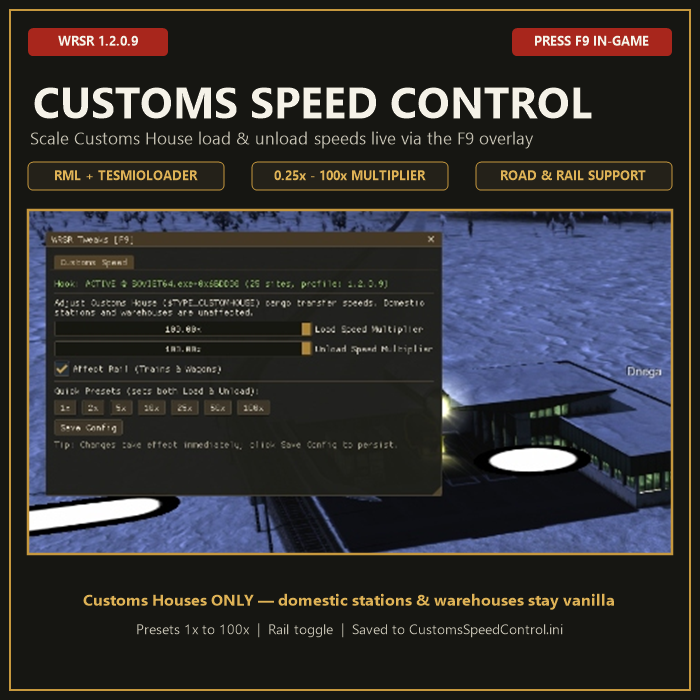

# CustomsSpeedControl

Native x64 C++20 plugin for **Workers & Resources: Soviet Republic** (`SOVIET64.exe`) that scales **Customs House (`$TYPE_CUSTOMHOUSE`)** cargo **Load** and **Unload** speeds at runtime (`0.25x` – `100.0x`) via the shared **`F9`** multi-mod overlay (`WRSR Tweaks [F9]`), while leaving domestic stations, warehouses, and factories untouched.

> **Alpha Status:** Consider this an early **Alpha** release. So far it has been tested on small/medium border setups across WRSR `1.1.1.13` and `1.2.0.9` — more testing is needed on large late-game republics with heavy rail and road Customs traffic. Always back up your saves and report any issues on GitHub!

> **Important:** Multipliers apply strictly at **Customs Houses (`$TYPE_CUSTOMHOUSE`)** before remaining vehicle/storage capacity clamping. Domestic loading/unloading elsewhere on your map runs at 100% vanilla speed, and when **Affect Rail** is enabled trains retain their natural relative speed advantage over road trucks.



## Quick Start (For Players New to Mod Loaders)

Regular Steam Workshop mods only add buildings, maps, or vehicles. Because **CustomsSpeedControl** adds an in-game `F9` overlay and live cargo-transfer scaling, it runs through a **Mod Loader**. Launching WRSR through Steam's normal **Play** button alone will **not** load `.dll` mods.

Both **TesmioLoader (`v0.4.5+`)** and **Republic Mod Loader (`v1.0.1`)** automatically scan your Steam Workshop folder — **no manual DLL copying needed**.

### Option A — TesmioLoader (Recommended, `v0.4.0+` Auto Workshop Discovery, tested vs `v0.4.5`)

1. Subscribe to **CustomsSpeedControl** on the [Steam Workshop](https://steamcommunity.com/app/784150/workshop/) or download the unified release zip from [GitHub Releases](https://github.com/ZydraHydra/WorkersAndResources-Modding/releases) (automatically detects `1.2.0.9`, `1.2.0.8`, `1.1.1.13`, `1.1.1.9`, and `1.1.1.7` at runtime).
2. Download and extract [**TesmioLoader**](https://github.com/MaxLegend/TesmioLoader/releases) ([Docs](https://maxlegend.github.io/TesmioLoaderDocs/#/getting-started)) into your WRSR game directory.
3. Run **`tesmiolauncher.exe`** — since **v0.4.0**, TesmioLoader automatically scans `steamapps\workshop\content\784150\` for compatible plugins (use `workshop_path` or the launcher selector if your Workshop lives in another Steam library).
4. Tick **CustomsSpeedControl**, launch the game, and press **`F9`** in-game!

### Option B — Republic Mod Loader (RML `v1.0.1`, All-on-Steam Alternative)

1. Subscribe to **CustomsSpeedControl** on the Steam Workshop.
2. Subscribe to [**Republic Mod Loader (RML)**](https://steamcommunity.com/sharedfiles/filedetails/?id=3787969749) ([GitHub](https://github.com/Ultimate-Universe/WRSR-RepublicModLoader)).
3. Run **`RepublicModLoader.exe`** from:
   ```text
   <Your Steam Library>\steamapps\workshop\content\784150\3787969749\RepublicModLoader.exe
   ```
   *(You can create a Desktop shortcut or add it to Steam as a Non-Steam Game.)*
4. Tick **CustomsSpeedControl** in RML, click **Launch**, and press **`F9`** once loaded into your savegame.

*(Manual / Non-Steam installs only: copy `plugins\CustomsSpeedControl.dll` from `<Steam Library>\steamapps\workshop\content\784150\<ID>\plugins\` or a GitHub Release zip into `<Game Dir>\plugins\`.)*

## Features & In-Game Usage

- **Shared `F9` Multi-Mod Overlay (`WRSR Tweaks [F9]`):** WRSR-themed Dear ImGui hub (`src/overlay/`) with hover-scoped mouse/keyboard locking (`F9` / `Esc` to close). Future utility mods embedding `src/overlay/` automatically appear as tabs in the same window.
- **Independent Load & Unload Multipliers (`0.25x` – `100.0x`):** Tune import loading and export unloading separately at Customs Houses. You can drag the sliders or `Ctrl+Click` a slider to type an exact value, and changes apply immediately on the next tick.
- **Quick Presets (`1x`, `2x`, `5x`, `10x`, `25x`, `50x`, `100x`):** One-click buttons to set both Load and Unload multipliers together (`1x` restores vanilla border speed instantly).
- **Rail Toggle (`Affect Rail (Trains & Wagons)`):** Decide whether multipliers also apply to rail wagons and locomotives (`VEHICLETYPE_RAIL_*`) docked at Customs Houses, or keep trains vanilla while speeding up road trucks.
- **Pre-Clamp Scaling:** Scales `C3D_TIMER::PowerTime` inside `VehicleCargoTransferTick` **before** building speed factors and remaining vehicle/storage capacity clamping (`minss`), preserving vanilla vehicle capacities and road-vs-rail base speed ratios.
- **INI Persistence (`CustomsSpeedControl.ini`):** Click **Save Config** (or press `Ctrl+S`) to persist settings beside `CustomsSpeedControl.dll` without altering any binary WRSR save files.

## Practical Examples

- **Clear Heavy Truck Border Queues:** Set `Load = 10x` / `Unload = 10x` (or `25x`–`100x` for near-instant bay turnover) so distribution and line trucks spend less time idling in narrow Customs bays without changing how your domestic industries load.
- **Asymmetric Import vs. Export Realism:** Set `Load = 5x` for fast bulk imports (e.g., gravel/fuel/waste) while keeping `Unload = 2x` so export trains/trucks turn around faster without feeling instant.
- **Road Boost Only, Vanilla Trains:** Uncheck **Affect Rail (Trains & Wagons)** if you want big freight trains to still take realistic loading time at rail border connections while small customs trucks clear quickly.

## Controls & INI Configuration

| Shortcut / Control | Action |
|---|---|
| `F9` | Toggle `WRSR Tweaks [F9]` overlay |
| `Esc` | Close overlay |
| `Ctrl+S` | Save settings to `CustomsSpeedControl.ini` |
| `Ctrl+Click` slider | Type an exact multiplier (`0.25` – `100.00`) |

Default `CustomsSpeedControl.ini` alongside `CustomsSpeedControl.dll` (editable via RML's **Open plugin INI**):

```ini
[settings]
load_multiplier=2.00
unload_multiplier=2.00
affect_rail=true
```
