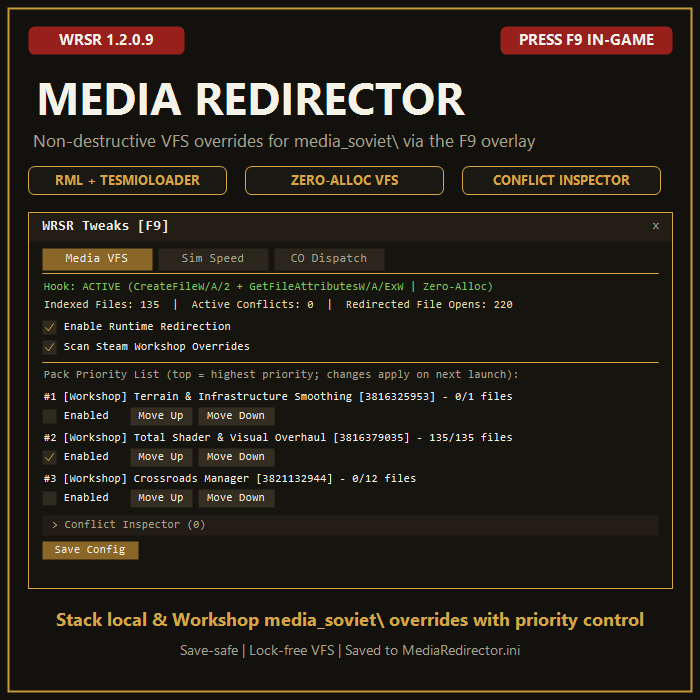
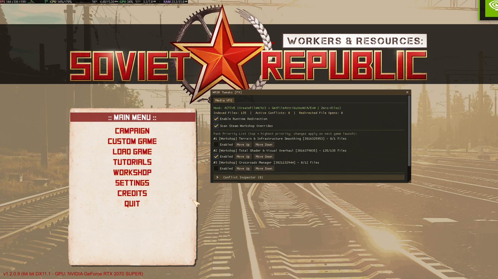
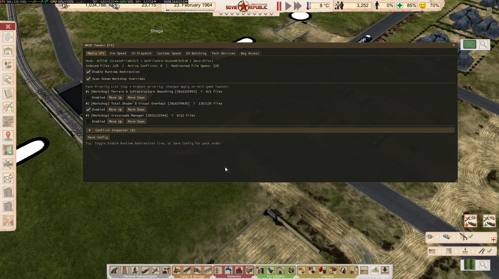

# MediaRedirector

Non-destructive Virtual File System (VFS) path redirector for **Workers & Resources: Soviet Republic** (`SOVIET64.exe`) that transparently redirects read-only file opens and attribute checks targeting `media_soviet\...` to override packs on disk—allowing players to stack local and Steam Workshop base-file replacement mods with priority ordering and conflict detection via the **`F9`** overlay, without ever overwriting original game files in `media_soviet\`.

> **Alpha Status:** Consider this an early **Alpha** release. Always back up your saves and test your override packs before relying on them in long-running republics.

> **Important:** [**Glorious Republic Mod Loader (GRML)**](https://steamcommunity.com/sharedfiles/filedetails/?id=3846999477) already includes MediaRedirector built-in! This standalone DLL plugin is primarily for **TesmioLoader (`v0.4.6+`)** or manual setups. Launching WRSR through Steam's normal **Play** button alone will **not** load `.dll` mods. All discovered override packs start **disabled by default**—nothing is auto-enabled until you opt in via the `F9` -> **Media VFS** tab (available right from the **Main Menu**!) or `MediaRedirector.ini`.







## Quick Start (For Players New to Mod Loaders)

### Option A — Glorious Republic Mod Loader (GRML, Recommended — Built-In)

1. Subscribe to [**Glorious Republic Mod Loader (GRML)**](https://steamcommunity.com/sharedfiles/filedetails/?id=3846999477) ([GitHub](https://github.com/ZydraHydra/GloriousRepublicModLoader)) — **MediaRedirector is already built into GRML**, so you don't need to install this standalone DLL separately.
2. Run **`GloriousRepublicModLoader.exe`** and press **`F9`** in-game to manage overrides.

### Option B — TesmioLoader (`v0.4.6+`, Legacy Standalone Alternative)

1. Subscribe to **MediaRedirector** on the [Steam Workshop](https://steamcommunity.com/sharedfiles/filedetails/?id=3846470422) or download the release zip from [GitHub Releases](https://github.com/ZydraHydra/WorkersAndResources-Modding/releases).
2. Download and extract [**TesmioLoader**](https://github.com/MaxLegend/TesmioLoader/releases) ([Docs](https://maxlegend.github.io/TesmioLoaderDocs/#/getting-started)) into your WRSR game directory.
3. Run **`tesmiolauncher.exe`**, tick **MediaRedirector**, launch the game, and press **`F9`** on the **Main Menu** (or in-game).

*(Manual / Non-Steam installs only: copy `MediaRedirector.dll`, `MediaRedirector.rml.json`, and `MediaRedirector.ini` into `<Game Dir>\plugins\`.)*

## Features & In-Game Usage (`F9` -> `Media VFS`)

- **Works on the Main Menu:** Unlike simulation-only `F9` tabs (which appear once a republic is loaded), **Media VFS** is immediately accessible on the Main Menu so you can enable, disable, and reorder override packs before loading a save.
- **Manual-Only Activation (Zero Auto-Enable):** Every newly discovered pack starts **disabled** (`false`). You explicitly choose which packs to activate.
- **Folder & `.zip` Override Support:** Discovers both extracted folders (`media_soviet\` or `override\`) and `.zip` archives containing `media_soviet\` or `override\` (at root or one folder deep) across:
  - Local drop-in packs: `<Game Dir>\media_overrides\<PackName>\` or `<Game Dir>\media_overrides\<PackName>.zip`
  - Subscribed Steam Workshop items across all configured Steam libraries (`steamapps\workshop\content\784150\<WorkshopID>\`)
- **Synchronous Early-Boot Indexing:** Builds the VFS lookup table and installs `CreateFileW`, `GetFileAttributesW`, and `GetFileAttributesExW` detours during `DllMain` before `SOVIET64.exe` parses core `.ini` definitions.
- **Zero-Allocation, Lock-Free Hot Path:** Uses an immutable post-init `std::wstring_view` hash map and stack-allocated `wchar_t[512]` path normalization—zero heap allocations and zero mutex locks inside `CreateFileW`.
- **Priority Ordering & Conflict Inspector:** Reorder packs with **Move Up** / **Move Down** (top = highest priority), inspect colliding `media_soviet\...` paths in the collapsible **Conflict Inspector**, and monitor live `Indexed Files`, `Active Conflicts`, and `Redirected File Opens` telemetry.

## Practical Examples

- **Testing Shader, Texture, or INI Overhauls Safely:** Subscribe to a Workshop overhaul (even `.zip`-packaged ones) or drop it into `<Game Dir>\media_overrides\`, enable it in `F9` -> **Media VFS**, click **Save Config**, and relaunch WRSR. Disable it anytime without ever verifying game files in Steam.
- **Resolving File Collisions:** Expand **Conflict Inspector** in `F9` -> **Media VFS** to see which `media_soviet\...` files are touched by multiple packs, then use **Move Up** / **Move Down** to pick the winner.

---

## Modder Integration Guide (For Content & Overhaul Creators)

Want your Workshop or manual mod to work **out-of-the-box** with **MediaRedirector** without asking players to overwrite their `media_soviet\` folder? Follow these simple conventions:

### 1. Supported Directory Layouts
Place your replacement files using the exact relative paths they would have inside the game's `media_soviet\` directory. **MediaRedirector** recognizes **any** of these layouts automatically:

- **Layout A — Standard `media_soviet\` folder (Recommended):**
  ```text
  <YourModRoot>/
  ├── workshopconfig.ini          # Optional; $ITEM_NAME "..." is shown in the F9 UI
  └── media_soviet/
      ├── buildings_types/
      │   └── incinerator_big.ini
      └── shaders/
          └── default_hdr.inix
  ```
- **Layout B — `override\` folder:**
  ```text
  <YourModRoot>/
  └── override/                   # Mapped directly to media_soviet\...
      └── buildings_types/
          └── incinerator_big.ini
  ```
- **Layout C — `.zip` Archive (Workshop or Local):**
  If you distribute a `.zip` file inside your Workshop item folder (or `media_overrides\MyMod.zip`), **MediaRedirector** automatically inspects its Central Directory and extracts **only when the user enables your mod**. Inside the `.zip`, place `media_soviet/...` or `override/...` either at the archive root or inside one top-level folder (e.g., `MyMod/media_soviet/...`).

### 2. Best Practices for Modders
- **Include Only Modified Files:** Never bundle unmodified vanilla files from `media_soviet\`—only include the files you actually changed. This keeps downloads small and prevents unnecessary collisions in the **Conflict Inspector**.
- **Set `$ITEM_NAME` in `workshopconfig.ini`:** MediaRedirector reads `$ITEM_NAME "Your Mod Title"` from `workshopconfig.ini` so players see a friendly title alongside your Workshop ID instead of a raw number.
- **No Destructive `.bat` Installers Needed:** You can keep manual install instructions for non-loader users, while letting TesmioLoader / RML + MediaRedirector users enable your mod non-destructively with one checkbox.
- **Do Not Include `MediaRedirector.dll` in Your Mod:** Simply list **MediaRedirector** as a recommended/required companion mod on your Workshop page so players always get the latest version.

---

## Controls & INI Configuration (`MediaRedirector.ini`)

| Shortcut / Control | Action |
|---|---|
| `F9` | Toggle `WRSR Tweaks [F9]` overlay (`Media VFS` tab) |
| `Esc` | Close overlay |
| `Ctrl+S` | Save settings, pack enablement, and priority order to `MediaRedirector.ini` |

```ini
[settings]
enabled=true
scan_workshop_overrides=true

[Priority]
0=ws:3816379035
1=local:MyCustomPack

[Enabled]
ws:3816379035=true
local:MyCustomPack=false
```

## Companion Mods

- [**AdaptiveSimSpeed**](../../mods/AdaptiveSimSpeed) — Hardware-adaptive fast-forward (`3x` – `15x`) via `F9`.
- [**CustomsSpeedControl**](../../mods/CustomsSpeedControl) — Scale Customs House cargo Load & Unload speeds (`0.25x` – `100x`) via `F9`.
- [**TradePriceLimits**](../../mods/TradePriceLimits) — Per-resource Max Buy / Min Sell price thresholds on Customs House dispatches via `F8`.
- [**SmartDOBatching**](../../mods/SmartDOBatching) — Prevent Distribution Offices from dispatching near-empty trucks or trains via `F9`.
- [**CODispatchControl**](../../mods/CODispatchControl) — Match Construction Office trucks and buses to site demand via `F9`.
- [**TechServiceControl**](../../mods/TechServiceControl) — Customize Technical Services dispatch thresholds via `F9`.
- [**SmartBayAccess**](../../mods/SmartBayAccess) — Eliminate single-vehicle courtyard bottlenecks at multi-bay road stations via `F9`.
