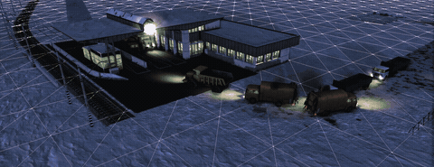

# SmartBayAccess

Native x64 C++ plugin for **Workers & Resources: Soviet Republic** (`SOVIET64.exe`) that eliminates single-vehicle courtyard bottlenecks at multi-bay road buildings (cargo stations, depots, Customs Houses, bus platforms) via the unified `F9` overlay.

- **Steam Workshop:** [SmartBayAccess (ID `3846054095`)](https://steamcommunity.com/sharedfiles/filedetails/?id=3846054095)
- **GitHub Releases:** [WorkersAndResources-Modding Releases](https://github.com/ZydraHydra/WorkersAndResources-Modding/releases)

## Demo

- **Video Demo:** [YouTube — SmartBayAccess Mod Demo](https://youtu.be/1YjFUKZOkso)

## Features

- **Multi-Bay Road Buildings Only:** Automatically passes through for 1-bay buildings and all rail/train traffic.
- **Same-Direction Batching (`mode = 1`, Default):** Allows multiple vehicles to enter simultaneously while none are exiting (and exit simultaneously while none are entering), preventing nose-to-nose deadlocks on dead-end stations.
- **Unrestricted Bay Entry (`mode = 2`):** Allows simultaneous entry and exit whenever a free physical bay exists for maximum throughput at busy Customs Houses.
- **Vanilla (`mode = 0`):** Restores vanilla single-mover apron lock behavior.
- **100% Save-Safe:** Uses external idempotent tracking (`std::unordered_map`) flushed on save load/unload (`header.bin`) and preserves per-bay slot reservations (`SmartBayAccess.ini`).
