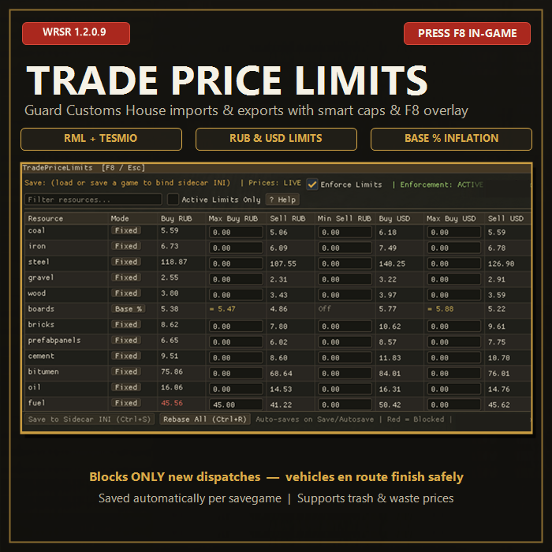

# TradePriceLimits

Native x64 C++20 plugin for **Workers & Resources: Soviet Republic** (`SOVIET64.exe`) that stops Distribution Offices (`Road` and `Rail`) from dispatching new imports above your **Max Buy** cap or new exports below your **Min Sell** floor at Customs Houses.

> **Alpha Status:** Consider this an early **Alpha** release. So far it has only been tested on smaller setups — more testing is needed on large, late-game republics with heavy Distribution Office and rail traffic. Always back up your saves and report any issues on GitHub!

> **Important:** Limits apply to **new** dispatches only — trucks and trains already on their way are never cancelled mid-trip and will finish their current journey.



## Quick Start (For Players New to Mod Loaders)

Regular Steam Workshop mods only add buildings, maps, or vehicles. Because **TradePriceLimits** adds an in-game `F8` menu and custom trade logic, it runs through a **Mod Loader**. Launching WRSR through Steam's normal **Play** button alone will **not** load `.dll` mods.

Both **TesmioLoader (`v0.4.5`)** and **Republic Mod Loader (`v1.0.1`)** automatically scan your Steam Workshop folder — **no manual DLL copying needed**.

### Option A — TesmioLoader (Recommended, `v0.4.0+` Auto Workshop Discovery, tested vs `v0.4.5`)

1. Subscribe to **TradePriceLimits** on the [Steam Workshop (`WRSR 1.2.0.8 & 1.1.1.7`)](https://steamcommunity.com/sharedfiles/filedetails/?id=3845533384) or download a release zip (`latest` / `1.1.1.7`) from [GitHub Releases](https://github.com/ZydraHydra/WorkersAndResources-Modding/releases).
2. Download and extract [**TesmioLoader**](https://github.com/MaxLegend/TesmioLoader/releases) ([Docs](https://maxlegend.github.io/TesmioLoaderDocs/#/getting-started)) into your WRSR game directory.
3. Run **`tesmiolauncher.exe`** — since **v0.4.0**, TesmioLoader automatically scans `steamapps\workshop\content\784150\` for compatible plugins (use `workshop_path` or the launcher selector if your Workshop lives in another Steam library).
4. Tick **TradePriceLimits**, launch the game, and press **`F8`** in-game!

### Option B — Republic Mod Loader (RML `v1.0.1`, All-on-Steam Alternative)

1. Subscribe to **TradePriceLimits** on the Steam Workshop (links above).
2. Subscribe to [**Republic Mod Loader (RML)**](https://steamcommunity.com/sharedfiles/filedetails/?id=3787969749) ([GitHub](https://github.com/Ultimate-Universe/WRSR-RepublicModLoader)).
3. Run **`RepublicModLoader.exe`** from:
   ```text
   <Your Steam Library>\steamapps\workshop\content\784150\3787969749\RepublicModLoader.exe
   ```
   *(You can create a Desktop shortcut or add it to Steam as a Non-Steam Game.)*
4. Tick **TradePriceLimits** in RML, click **Launch**, and press **`F8`** once loaded into your savegame.

*(Manual / Non-Steam installs only: copy `plugins\TradePriceLimits.dll` from `<Steam Library>\steamapps\workshop\content\784150\<ID>\plugins\` or a GitHub Release zip into `<Game Dir>\plugins\`.)*

## Features & In-Game Usage

- **In-Game Overlay (`F8` / `Esc`):** WRSR-themed Dear ImGui panel with cursor capture, search filter, `Active Limits Only` toggle, `? Help` guide, and header tooltips.
- **Separate RUB & USD Limits:** Configure Soviet Customs (`RUB`) and Western Customs (`USD`) independently.
- **Two Modes per Resource:**
  - **Fixed:** Exact RUB and USD limits (`0` = disabled). Example: setting `Max Buy RUB = 45` on `fuel` blocks Soviet fuel imports whenever price exceeds `45 RUB/t`.
  - **Base % (Inflation-Resilient):** Scales limits as a `%` of captured **Baseline** Buy and Sell prices (`Max Buy %` relative to Baseline Buy, `Min Sell %` relative to Baseline Sell). Click **Rebase** (or `Ctrl+R`) to snapshot today's market prices as `100%`.
- **Negative Prices (Trash / Waste):** Signed limits work directly — e.g., `Max Buy RUB = -300` on toxic waste only allows imports when Customs pays you at least `300 RUB/t`.
- **Emergency Bypass (`Enforce Limits`):** Uncheck in the overlay header to pause all blocking immediately without losing your settings.
- **Blocked Checks Readout:** Live counter in the overlay header showing blocked Distribution Office task evaluations since the last Save / Autosave / Load.
- **Save-Safe Sidecar (`trade_price_limits.ini`):** Auto-loads when opening a save and auto-saves on Save / Autosave / `Ctrl+S` inside the save folder without modifying WRSR's binary save files.

## Controls & Rebinding

| Shortcut / Control | Action |
|---|---|
| `F8` *(default)* | Toggle TradePriceLimits overlay |
| `Esc` | Close overlay |
| `Ctrl+S` | Save rules to active save's `trade_price_limits.ini` |
| `Ctrl+R` | Rebase all resources to current live market prices |

To change the overlay toggle key, edit `[__settings]` in your save folder's `trade_price_limits.ini`:

```ini
[__settings]
enforcement_enabled=1
toggle_key=F8
```

Supported values: `F1`–`F12`, `Insert`, `Delete`, `Home`, `End`, `PageUp`, `PageDown`, `Pause`, `ScrollLock`, `Tab`, `Tilde`, single letters/digits (`A`–`Z`, `0`–`9`), or a hex Windows virtual-key code (e.g. `0x78`).
